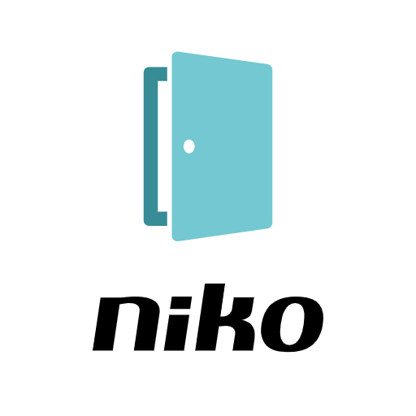

# Niko Access Control for Home Assistant

[](https://github.com/hacs/integration)
[](https://github.com/claesmathias/niko_access_control-hacs/releases)
[](LICENSE)



Integrate your **Niko Access Control** video doorbell into Home Assistant via the HikConnect cloud API (reverse-engineered from the official Niko Access Control Android app v3.0).

---

## Features

| Entity | Type | Description |
|--------|------|-------------|
| Doorbell | Event (doorbell) | Fires `ring` when someone presses the button — use this to trigger automations (shows *Unknown* until the first ring) |
| Ringing ¹ | Binary sensor | On while the doorbell is ringing |
| Call state ¹ | Sensor (enum) | `Idle`, `Ringing` or `On call` |
| Answer call / Reject call ¹ | Button | Available while the doorbell is ringing |
| Hang up ¹ | Button | Available while a call is in progress |
| Last call | Image | Snapshot captured at the last ring |
| Last call time | Sensor (timestamp) | Time of the most recent ring, with the call history in attributes |
| Last call status | Sensor (enum) | `Answered` or `Missed` |
| Calls today | Sensor | Rings since midnight, with `answered` / `missed` counts in attributes |
| Online | Binary sensor (diagnostic) | Whether the doorbell is online in the HikConnect cloud |
| IP address | Sensor (diagnostic) | Local IP address of the doorbell |

¹ Only on doorbells that report a live call state. The Niko 510-31001 outdoor unit doesn't: the cloud answers "device not online" for its call status and call control, so these entities aren't created and rings are detected from the call history (checked every 10 s) instead. If local access is configured in the integration options, the doorbell's local call status is tried first.

Model, firmware, hardware version, serial number and MAC address are shown on the device page.

### Call history in the Media panel

Snapshots of all calls in the cloud history (the last 50) can be browsed under **Media → Niko Access Control**, grouped by day:

```
Media → Niko Access Control → Front door
   ├── Today · 3 calls, 1 missed
   │    ├── 14:32:05 · Missed
   │    └── 09:15:40 · Answered
   └── Yesterday · 1 call
```

Pictures are fetched from the cloud when opened and cached in memory; nothing is stored on disk.

### Notifications

Enable under **Settings → Devices & services → Niko Access Control → Configure → Notifications**. On each ring, a push notification is sent to Home Assistant Companion app devices — all of them, or the ones you select — with:

- the time of the ring and the snapshot of that call
- a configurable title and message (`{time}` and `{date}` placeholders), e.g. *“Er werd gebeld om {time}”*
- optional time-sensitive delivery (breaks through Focus on iPhone, high priority on Android)
- tapping opens the call history in the Media panel

To try it, choose **Send test notification** in the same Configure menu, or press the **Test notification** button on the device page (shown while notifications are on). It sends the last call right away. No notify group or automation is needed.

### Actions

`niko_access_control.answer_call`, `reject_call`, `hangup_call` and `announce` (speech through the doorbell speaker; needs local access in the integration options). Pick the doorbell with the device selector; with a single doorbell it can be left empty. The old `device_serial` field still works.

---

## Supported devices

Any Niko Access Control doorbell that is registered with a HikConnect / Niko Smart Home account. Tested with:

- **Niko Access Control single-unit doorbell** (`510-31001`)

---

## Prerequisites

- A **Niko Smart Home** account (created in the Niko Access Control app)
- The doorbell already added and working in the Niko Access Control app

---

## Installation

### Via HACS (recommended)

1. Open HACS in Home Assistant
2. Go to **Integrations**
3. Click the ⋮ menu → **Custom repositories**
4. Add `https://github.com/claesmathias/niko_access_control-hacs` with category **Integration**
5. Search for **Niko Access Control** and install
6. Restart Home Assistant

### Manual

1. Copy `custom_components/niko_access_control/` to your HA `config/custom_components/` directory
2. Restart Home Assistant

---

## Configuration

1. Go to **Settings → Devices & services → Add integration**
2. Search for **Niko Access Control**
3. Sign in with your Niko Access Control app account (email or phone number and password)
4. Pick your doorbell from the list of devices on your account

If the device list can't be loaded, you're asked for the serial number instead (Niko app: Menu → Info → System information → Product number).

---

## Automation examples

### Notify with a picture when someone rings

```yaml
automation:
  - alias: "Doorbell notification"
    triggers:
      - trigger: state
        entity_id: event.front_door_doorbell
    actions:
      - delay: 10  # give the cloud time to store the snapshot
      - action: notify.mobile_app
        data:
          title: "Someone at the door"
          message: "Doorbell rang at {{ now().strftime('%H:%M') }}"
          data:
            image: /api/image_proxy/image.front_door_last_call
```

Entity IDs depend on the device name from the Niko app; check them under **Settings → Devices & services → Niko Access Control**.

---

## Upgrading from 2.x

Version 3.0 removes the separate firmware/model/serial/MAC sensors (now on the device page), the `Total calls` sensor (replaced by `Calls today`), and the up-to-50 `Answered`/`Missed` image entities (all call snapshots are now in the Media panel). Automations using those entities need updating. The old entities are removed automatically. Requires Home Assistant 2024.11 or newer.

---

## Technical notes

- This integration uses the same cloud API as the official **Niko Access Control** app (v3.0).
- It communicates exclusively with the **HikConnect / GuardingVision cloud API** (`api.guardingvision.com` / `apiieu.hik-connect.com`).
- All API calls use `clientType: 378` (the Niko OEM app type) and `appId: NIKO`.
- Passwords are transmitted as lowercase MD5 hashes, as the official app does.
- Live streaming is **not** supported — it requires the proprietary HikConnect VSDK native library which cannot run in Python.

---

## Disclaimer

This integration is not affiliated with, endorsed by, or supported by **Niko** or **Hikvision**. Use at your own risk. The API may change without notice.

---

## License

MIT License — see [LICENSE](LICENSE) for details.
